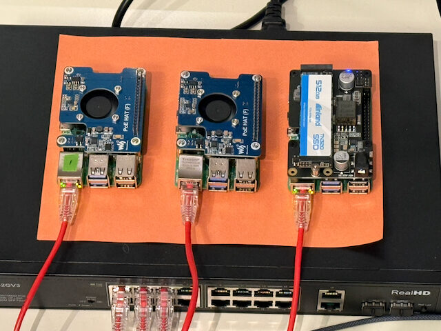
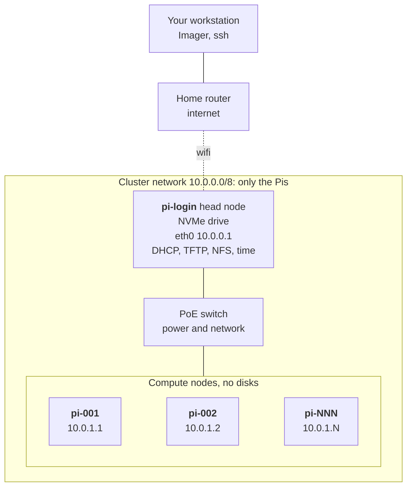
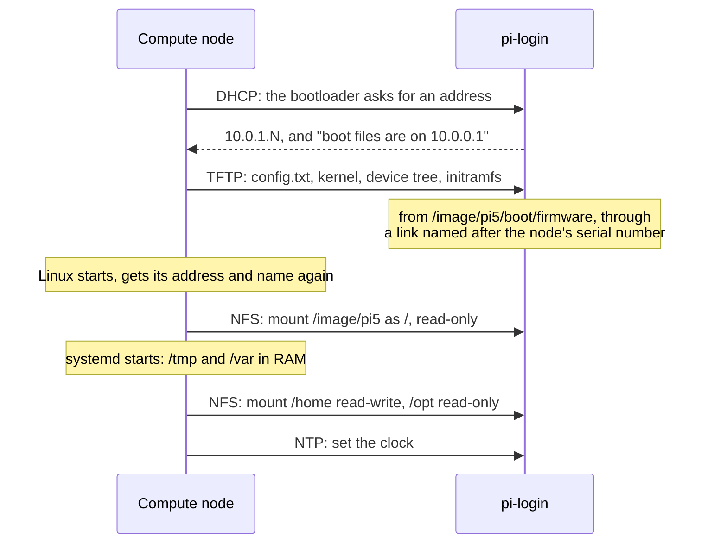
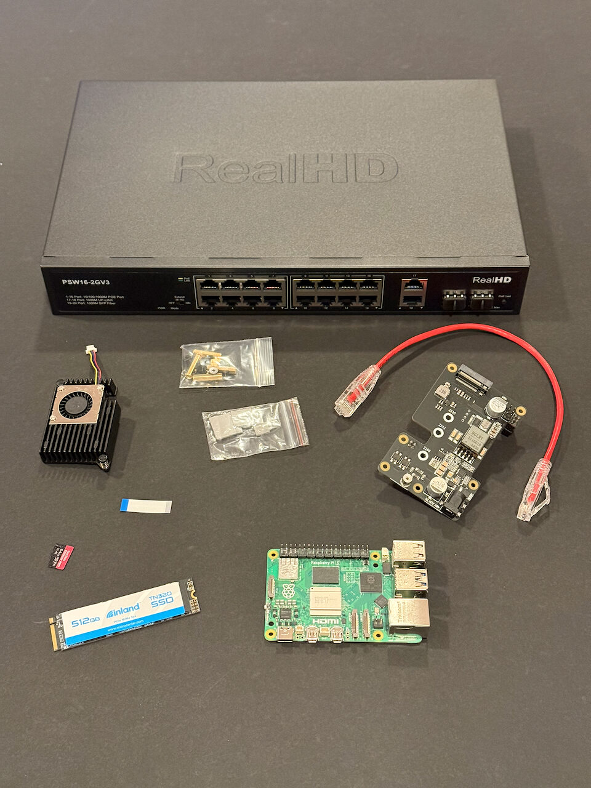
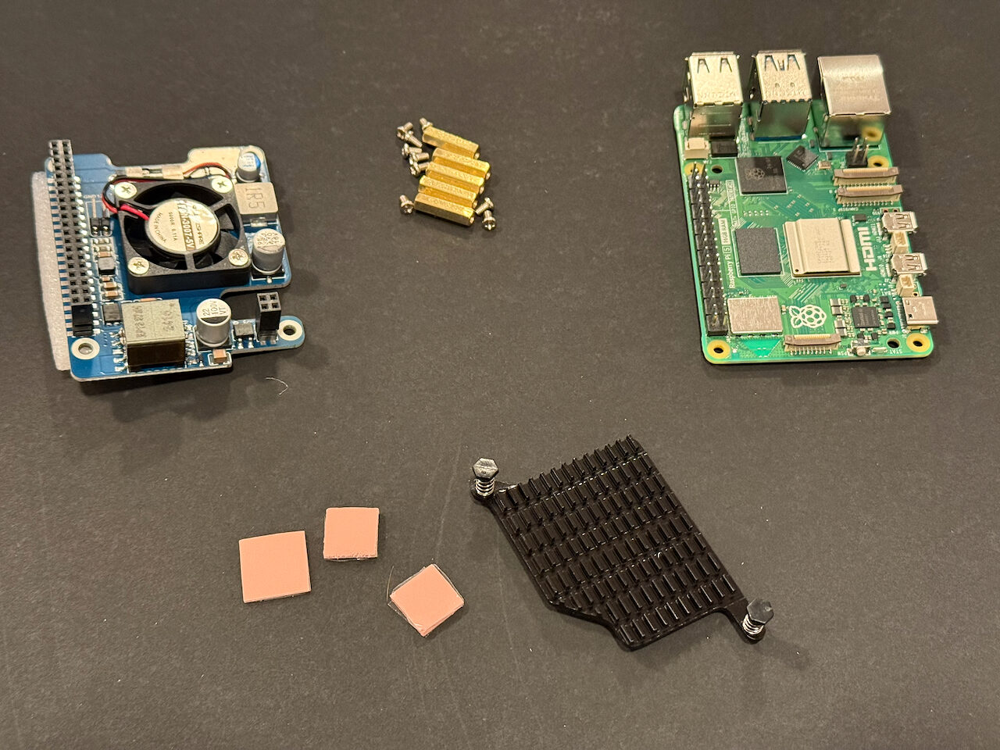
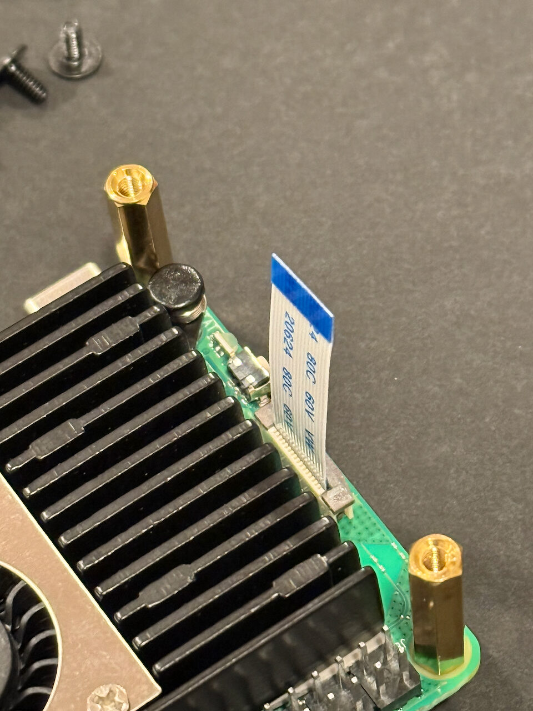
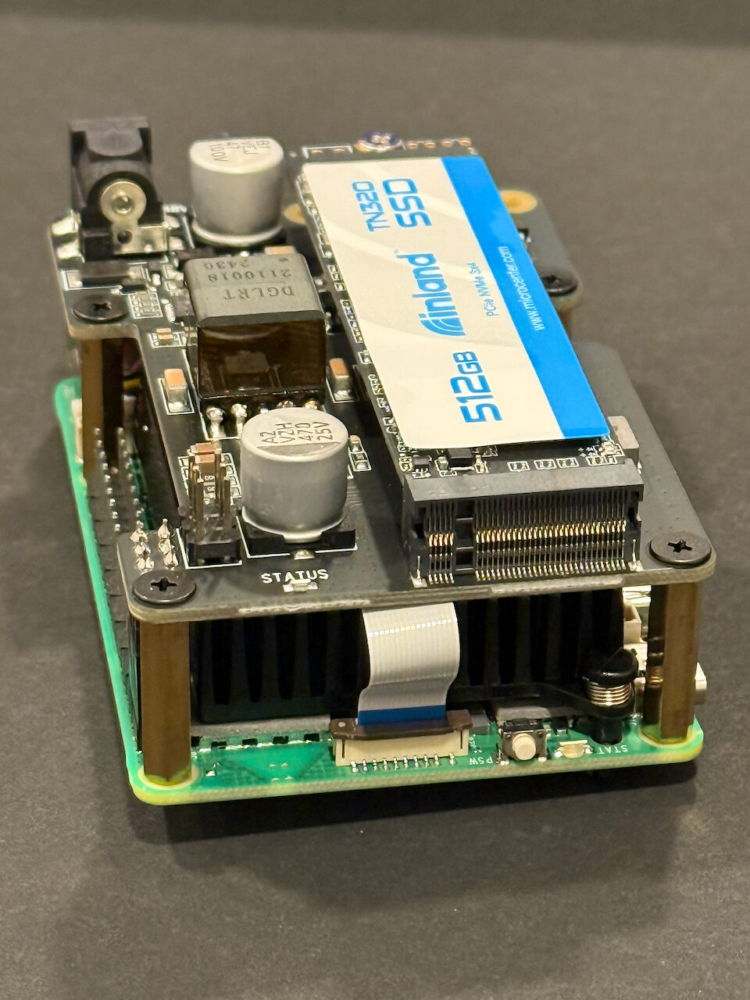
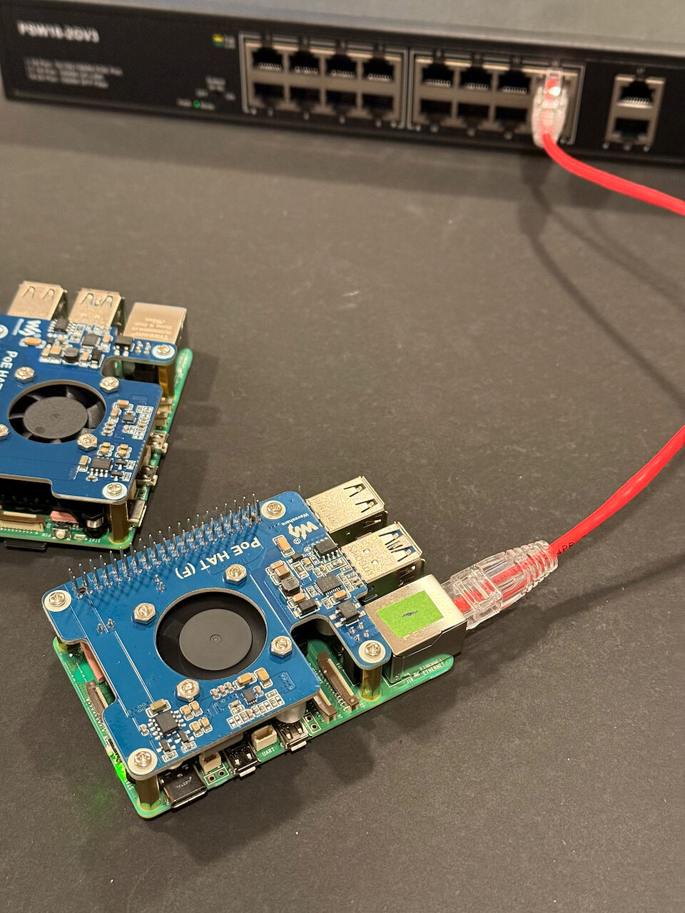
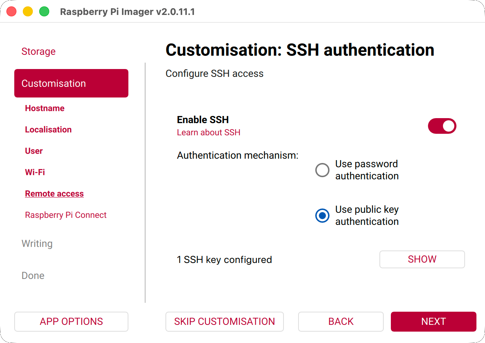

# Raspberry Pi 5 cluster

A small [Slurm](https://slurm.schedmd.com/) cluster built from Raspberry Pi 5 boards.
One head node boots from an NVMe drive and provides everything else. Compute nodes have
no storage of their own: they boot over the network and share a single read-only operating
system, so adding a node is one command and one cable, after a one-time bootloader setting.
The guide and its scripts were written with AI help; the [AI statement](#ai-statement) says how.



## How it works



|                 | Head node                                              | Compute node N                           |
| --------------- | ------------------------------------------------------ | ---------------------------------------- |
| Boots from      | NVMe                                                   | The network: TFTP, then an NFS root      |
| Root filesystem | NVMe, read-write                                       | `/image/pi5` on the head node, read-only |
| `/home`         | Local                                                  | Shared from the head node, read-write    |
| `/opt`          | Local                                                  | Shared from the head node, read-only     |
| `/tmp`, `/var`  | Local                                                  | RAM                                      |
| Network         | Wifi to the internet; `eth0` at 10.0.0.1 to the switch | `eth0` at 10.0.1.N                       |
| Runs            | DHCP, TFTP, NFS, time, Slurm controller                | Slurm worker                             |

DHCP hands out addresses, TFTP serves the first boot files and NFS shares directories over the
network; the head node runs all three. Because `/home` is shared, your files and your ssh key
are the same on every node. Compute nodes have no internet access. Software for them is installed
into the shared image from the head node (see Maintenance), or put under `/opt` on the head node,
which every node sees.

A compute node has no disk, so it gets everything from the head node when it powers on:



Registering a node (section 4) records its hardware address for DHCP and links its serial
number to the boot files; that is all a new node needs.

Your workstation needs only Raspberry Pi Imager and an OpenSSH client, on macOS, Linux or
Windows. Everything else is a handful of bash scripts that run on the head node and read one
settings file, `cluster.env`. Every script can be run again safely: finished steps are skipped.

```
pi-cluster/
├── cluster.env          your settings: user, hostnames, addresses, OS image
├── head/
│   ├── 10-nvme.sh       copy the head node from microSD to NVMe
│   ├── 20-netboot.sh    turn the head node into a network boot server
│   ├── 25-slurm.sh      add Slurm: the controller, slurmd in the image, the cluster's key
│   ├── 30-add-node.sh   register one compute node
│   ├── image-run.sh     run a command inside the compute node image
│   └── lib.sh           shared by the scripts above
└── docs/images/         the figures in this guide
```

## Parts

| Part                                          | Notes                                                                                         |
| --------------------------------------------- | --------------------------------------------------------------------------------------------- |
| Raspberry Pi 5, 4 GB                          | Head node                                                                                     |
| Raspberry Pi 5, 16 GB, × 4                    | Compute nodes                                                                                 |
| Geekworm X1012 PoE+ HAT with M.2 NVMe adapter | Head node: power from the switch, and the SSD slot                                            |
| Inland TN320 512 GB NVMe SSD                  | Head node system drive                                                                        |
| Geekworm H505 active cooler                   | Head node                                                                                     |
| Waveshare PoE HAT (F), × 4                    | Compute nodes: power from the switch, and a fan (see Notes: Fan)                              |
| RealHD 16-port PoE+ switch (PSW16-2GV3)       | Connects and powers every node: 300 W PoE budget, up to 30 W a port; the Pis link at 1 Gbit/s |
| Ethernet cable, × 5                           |                                                                                               |
| microSD card, 8 GB or more                    | Installs the head node, then sets each compute node's bootloader                              |
| Case or rack                                  | Optional; not used here                                                                       |

**PoE budget.** A PoE (Power over Ethernet) switch shares one total power budget across its
ports, and that budget, not the port count, limits how many Pis it can run. A 16-port switch
usually cannot power 16 Pi 5s under load. Add up the most each PoE HAT can draw (its PoE class;
the head node's PoE+ HAT counts too) and keep the total under the budget in the switch's
specifications. A switch that runs out may cut power to a port, which looks like a node that
reboots at random under load. The RealHD switch above has 300 W for 16 ports: enough for ten at
the full 30 W, and the five Pis here need at most 150 W.

<p align="center">
  
  <br>
  <em>Left: the head node's parts and the switch. Right: one compute node's parts.</em>
</p>

## Assembly

1. Head node: fit the cooler, then the X1012 HAT on its standoffs, with its ribbon cable in the
   Pi's PCIe connector and the SSD in its M.2 slot.
2. Compute nodes: fit a PoE HAT with cooler to each.
3. Power the switch. Connect nothing but the nodes to it, not even your home router: the head
   node reaches the internet over wifi.
4. Do not connect the nodes yet. A node powers on the moment it is plugged into the switch, and
   the steps below say when.

<p align="center">
  
  
  <br>
  <em>The head node's ribbon cable in the PCIe connector; the finished head node; a compute node on the switch.</em>
</p>

## Set up the workstation

Each command block starts with a comment that says where to run it: `# workstation` is your own
computer, and `# pi-login` is an ssh session on the head node (`ssh pi-login`). Quick checks run
on the workstation and reach into the cluster with `ssh pi-login …` or `ssh pi-001 …`.

On the workstation:

1. Make an ssh key for the cluster.

   ```bash
   # workstation
   ssh-keygen -t ed25519 -f ~/.ssh/pi-cluster
   ```

2. Add this to `~/.ssh/config` (on Windows, `C:\Users\<you>\.ssh\config`). It lets you type
   `ssh pi-login` or `ssh pi-001` from anywhere; compute nodes are reached through the head node.
   `ForwardAgent` passes your ssh agent to pi-login, so `ssh pi-001` also works from there;
   `AddKeysToAgent` puts the key in the agent the first time you connect. The compute nodes share
   one host key, and `HostKeyAlias` files it under one name, so ssh asks about it once for all of
   them.

   ```
   # ~/.ssh/config on the workstation
   Host pi-login
       HostName pi-login.local
       ForwardAgent yes
   Host pi-* !pi-login
       ProxyJump pi-login
       HostKeyAlias pi-nodes
   Host pi-*
       User pi
       IdentityFile ~/.ssh/pi-cluster
       AddKeysToAgent yes
   ```

3. Clone this repository, or download it and rename the unpacked folder to `pi-cluster`: the
   commands below use that name. Then read `cluster.env`. Its defaults match the parts list: user
   `pi`, head node `pi-login`, compute nodes `pi-001`, `pi-002` and so on, each with 4 cores and
   16 GB. Lower `NODE_MEMORY` if your compute nodes have less memory, and choose another private
   range for `CLUSTER_NET`, `HEAD_IP` and `NODE_SUBNET` if your home network already uses
   10.x.x.x addresses; `20-netboot.sh` checks and stops if it does. If you change the user or
   hostnames, change them in the ssh config above and in Imager below as well.

## 1. Flash the head node card

Write the microSD card with [Raspberry Pi Imager](https://www.raspberrypi.com/software/). Its
screens, in order:

| Screen               | Choose                                                                                     |
| -------------------- | ------------------------------------------------------------------------------------------ |
| Device               | Raspberry Pi 5                                                                             |
| OS                   | Raspberry Pi OS (other) → Raspberry Pi OS Lite (64-bit)                                    |
| Storage              | The microSD card                                                                           |
| Hostname             | `pi-login`, the `HEAD_NODE` in `cluster.env`                                               |
| Localisation         | Your capital city, time zone and keyboard layout                                           |
| User                 | `pi`, the `CLUSTER_USER` in `cluster.env`, and a password                                  |
| Wi-Fi                | Your wifi network and its password. This is the head node's link to the internet           |
| Remote access        | Enable SSH, use public key authentication, and add the contents of `~/.ssh/pi-cluster.pub` |
| Raspberry Pi Connect | Leave it off                                                                               |

<p align="center">
  
</p>

Put the card in the head node and connect it to the switch, which powers it. The first boot
applies your Imager settings and takes two or three minutes before ssh answers. Then connect; the
first connection asks whether to trust the head node's host key, so answer `yes`:

```bash
# workstation
ssh pi-login uptime
```

It prints the head node's uptime. `pi-login.local` is the name the head node announces on your
home network; if it does not resolve, find the head node's address in your router and use it as
`HostName` in the ssh config.

## 2. Move the head node to NVMe

Copy the repository to the head node and run the first script. It makes new partitions that
fill the NVMe drive and copies the running system onto them, file by file. If the Pi does not see
the drive, the script enables the PCIe slot and reboots the head node, which ends your ssh
session. After a minute, `ssh pi-login` again and run the script a second time; that run also
tells the bootloader to look for the drive, then continues. On the head node, `sudo` asks for the
password you gave `pi` in Imager, not your workstation's.

Before it copies anything, the script lists what is on the NVMe drive and asks
`Erase /dev/nvme0n1 and copy /dev/mmcblk0 onto it? [y/N]`. Answering `y` erases the drive, so
first save anything you want from an older system on it. The copy takes a few minutes.

```bash
# workstation, from the directory that contains pi-cluster
scp -r pi-cluster pi-login:
ssh pi-login
```

```bash
# pi-login
sudo bash pi-cluster/head/10-nvme.sh
sudo shutdown now
```

When the LED next to the head node's power button turns red, the system has shut down. Unplug
the head node from the switch, remove the microSD card, which section 4 uses again, and plug the
head node back in. After a minute or so it has booted from NVMe:

```bash
# workstation
ssh pi-login findmnt -n -o SOURCE /
```

prints a `/dev/nvme…` device.

## 3. Enable network boot and Slurm

One script turns the head node into a boot server. It takes five to twenty minutes, mostly
downloading and unpacking the operating system image. It

- configures `eth0` as 10.0.0.1, without a reboot,
- installs and configures DHCP, TFTP, NFS and a time server,
- downloads the current Raspberry Pi OS Lite image, checks it and unpacks it to `/image/pi5`,
- turns that copy into a network-boot image: NFS root, RAM for `/tmp` and `/var`, your user
  account, one set of ssh host keys for every node, no wifi, and TCP segmentation offload off on
  `eth0` (see Troubleshooting),
- records the nodes' and pi-login's host keys on both sides, so ssh between pi-login and the
  nodes never asks about them,
- serves the image's `/boot` over TFTP and exports `/image/pi5`, `/home` and `/opt` over NFS,
- turns off cloud-init on the head node. Imager uses it to apply your settings on the first
  boot; after that it would rewrite `/etc/hosts` at every boot and drop the node names.

```bash
# pi-login
sudo bash pi-cluster/head/20-netboot.sh
```

It ends with the three exports, as `showmount -e` lists them, and the next command to run.

Then add [Slurm](https://slurm.schedmd.com/), the job scheduler. A second script makes the
cluster's key, installs the Slurm controller on pi-login and the Slurm node daemon in the compute
image. Nodes get Slurm's settings from pi-login when they boot, so each node you register in
section 4 joins Slurm by itself; the controller starts with the first one.

```bash
# pi-login
sudo bash pi-cluster/head/25-slurm.sh
```

It takes a few minutes and ends by saying that the Slurm controller starts with the first
registered node.

## 4. Add compute nodes

Each node takes two steps: set its bootloader to boot from the network, which a board needs only
once, then register it with the head node.

### Set each node's bootloader, once

As shipped, a Pi 5's bootloader tries the microSD card, NVMe and USB, but not the network. Write
the microSD card from section 1 with Imager; the head node no longer needs it, and the same card
sets every node. Keep it for replacement boards, and never put it in the head node: it would set
the head node to boot from the network instead of its NVMe drive.

| Screen  | Choose                                                        |
| ------- | ------------------------------------------------------------- |
| Device  | Raspberry Pi 5                                                |
| OS      | Misc utility images → Bootloader (Pi 5 family) → Network Boot |
| Storage | The microSD card                                              |

This image has no settings screens. Then, for each node:

1. Put the card in the node and connect the node to the switch, which powers it.
2. Wait until the green LED flashes rapidly without stopping, which takes less than 30 seconds.
   A connected screen turns green; red means the update failed.
3. Unplug the node and remove the card.

### Register each node

Start `30-add-node.sh` on pi-login first, and plug the node in only when the script asks. The
script takes the first unregistered node it hears from, so keep the other new nodes unplugged.
If a node went in too early, unplug it and plug it in again when the script asks. Ctrl-C stops
the script at any point; running it again continues where it left off. For node 1, with the node
unplugged:

```bash
# pi-login
sudo bash pi-cluster/head/30-add-node.sh 1
```

When the script says `connect node 1 to the switch now`, plug the node in. The script sees
the node ask for an address and records its hardware address and name, then sees its first
boot request and records its serial number:

```
==> connect node 1 to the switch now; waiting for its DHCP request
==> pi-001 has MAC 2c:cf:67:c6:7d:83
==> wrote /etc/hosts
==> wrote /image/pi5/etc/hosts
==> waiting for pi-001 to ask for its boot files
==> pi-001 boots from /image/pi5/boot/8baee41e
==> wrote /etc/slurm/cgroup.conf
==> wrote /etc/slurm/slurm.conf
==> wrote /etc/slurm/slurm-local.conf
==> started slurmctld

pi-001  MAC 2c:cf:67:c6:7d:83  serial 8baee41e  address 10.0.1.1
It is up about a minute after its first boot request. From your workstation:
  ssh pi-001 uptime
```

The script also adds the node to Slurm; registering node 1 starts the Slurm controller. About a
minute later the node is up. The first connection to any node asks once about the nodes' shared
host key:

```bash
# workstation
ssh pi-001 uptime
```

Repeat with 2, 3, … for the other nodes. Node N is `pi-NNN` at 10.0.1.N.

## 5. Check the cluster

```bash
# workstation
ssh pi-login systemctl is-active dnsmasq nfs-server chrony
ssh pi-001 'findmnt -n -o TARGET,SOURCE,OPTIONS -t nfs,nfs4; timedatectl show -p NTPSynchronized'
```

```
active
active
active
/       10.0.0.1:/image/pi5 ro,relatime,vers=3,…
├─/home 10.0.0.1:/home      rw,relatime,vers=4.2,…
└─/opt  10.0.0.1:/opt       ro,relatime,vers=4.2,…
NTPSynchronized=yes
```

The head node's three services are running; the node's root is the image, read-only, with
`/home` read-write and `/opt` read-only (mount options shortened here); and its clock is set.

```bash
# workstation
ssh pi-login 'sinfo; srun -N1 hostname'
```

```
PARTITION AVAIL  TIMELIMIT  NODES  STATE NODELIST
main*        up   infinite      4   idle pi-[001-004]
pi-001
```

`sinfo` lists every registered node as `idle` in the partition `main`, and `srun` prints the name
of the node that ran it. A fuller checklist, with the expected output of every step, is in
[docs/testing.md](docs/testing.md).

## Running jobs

Submit jobs from pi-login with `srun`, `sbatch` or `salloc`; Slurm's
[quick start](https://slurm.schedmd.com/quickstart.html) shows them. One partition, `main`, holds
every registered node and is the default. Slurm hands out cores and memory: a job that does not
say how much memory it needs gets `NODE_MEMORY / NODE_CPUS` MiB per core, and a job that uses
more than it has is stopped rather than swapping. Your home directory is the same on every node.
Slurm authenticates with the cluster's key, so munge, which Debian's Slurm packages install and
most Slurm guides set up, stays off. There is no accounting database and no MPI setup.

## Maintenance

Compute nodes keep nothing of their own: unplug a node's cable to switch it off, and plug it back
in to start it. Switch the nodes off before changing the image they run from; `image-run.sh` warns
if one is still running.

| Task                              | How                                                                                                                                                                                                                                                                                                                                                |
| --------------------------------- | -------------------------------------------------------------------------------------------------------------------------------------------------------------------------------------------------------------------------------------------------------------------------------------------------------------------------------------------------- |
| Update the scripts                | `scp -r pi-cluster pi-login:` again, or `git pull` if you cloned on the head node                                                                                                                                                                                                                                                                  |
| Start over from a blank card      | Remove the old host keys on the workstation (`ssh-keygen -R pi-login.local`, `ssh-keygen -R pi-nodes`), write a new card as in section 1, and follow this guide again. `10-nvme.sh` lists what is on the NVMe drive and asks before erasing it, compute image, `/home` and node registry included. Skip the bootloader step for boards already set |
| Replace a node's board            | Set the new board's bootloader as in section 4. Then unplug the old board, run `sudo bash pi-cluster/head/30-add-node.sh N --replace`, and connect the new board when asked                                                                                                                                                                        |
| Update the compute image          | With the nodes unplugged, `sudo bash pi-cluster/head/image-run.sh apt update`, the same with `apt full-upgrade -y`, then plug the nodes back in                                                                                                                                                                                                    |
| Open a shell in the compute image | `sudo bash pi-cluster/head/image-run.sh`                                                                                                                                                                                                                                                                                                           |
| Rebuild the compute image         | With the nodes unplugged, `sudo rm -rf /image/pi5`, then run `20-netboot.sh` and `25-slurm.sh` again; the operating system image is downloaded again only if a newer release is out. Registered nodes stay registered and boot from the new image. It has new host keys: on the workstation, `ssh-keygen -R pi-nodes`                              |
| Change Slurm settings             | Add them to `/etc/slurm/slurm-local.conf` on pi-login, then `sudo scontrol reconfigure`. The scripts never change that file                                                                                                                                                                                                                        |
| Re-run any script                 | Always safe. Finished steps are skipped                                                                                                                                                                                                                                                                                                            |


## Troubleshooting

| Symptom                                                                    | What to check                                                                                                                                                     | Fix                                                                                                                                                                         |
| -------------------------------------------------------------------------- | ----------------------------------------------------------------------------------------------------------------------------------------------------------------- | --------------------------------------------------------------------------------------------------------------------------------------------------------------------------- |
| `ssh pi-login` cannot find the host                                        | Whether `pi-login.local` resolves on your network                                                                                                                 | Use the head node's address from your router as `HostName` in the ssh config                                                                                                |
| ssh refuses with `REMOTE HOST IDENTIFICATION HAS CHANGED`                  | Whether you rebuilt the head node or the compute image, which gives them new host keys                                                                            | On the workstation, `ssh-keygen -R pi-login.local` for the head node or `ssh-keygen -R pi-nodes` for the compute nodes, then connect again                                  |
| `10-nvme.sh` finds no NVMe drive after its reboot                          | The ribbon cable at both ends (Assembly photo) and the SSD in its slot                                                                                            | Reseat them and run the script again                                                                                                                                        |
| `20-netboot.sh` says your wifi network already uses an address             | Your home network uses the cluster's addresses                                                                                                                    | Choose another private range for `CLUSTER_NET`, `HEAD_IP` and `NODE_SUBNET` in `cluster.env` and run the script again                                                       |
| `30-add-node.sh` never sees the node                                       | `journalctl -u dnsmasq -f` on pi-login shows requests as they arrive                                                                                              | Set the node's bootloader again (section 4)                                                                                                                                 |
| The node gets an address but does not boot                                 | `journalctl -u dnsmasq -f` on pi-login shows what it asks for over TFTP; `pieeprom.sig` and `armstub8-2712.bin` not found are normal                              | The link named after its serial number must exist in `/image/pi5/boot/`: `20-netboot.sh` makes it again for every registered node                                           |
| A node boots without `/home`                                               | `sudo exportfs -v` on pi-login must list `/home` for 10.0.1.0/24                                                                                                  | Run `20-netboot.sh` again                                                                                                                                                   |
| A node is `down` or `drained` in `sinfo`                                   | `scontrol show node pi-001` on pi-login gives the reason; `journalctl -u slurmd -b` on the node shows slurmd's side                                               | A node with less memory than `NODE_MEMORY` in `cluster.env` is drained: lower the value, run `25-slurm.sh` again, then `sudo scontrol update NodeName=pi-001 State=RESUME`  |
| A node stops answering for a while, although its link lights keep blinking | `journalctl -k \| grep 'NETDEV WATCHDOG'` on the node, before it reboots: the nodes keep their logs in RAM                                                        | The Pi 5's Ethernet sometimes stops sending, and the kernel restarts it after about five seconds. The image already turns off TCP segmentation offload, a common workaround |
| A node reboots at random under load                                        | The PoE HATs' total draw against the switch's PoE budget (Parts)                                                                                                  | Fewer nodes on the switch, or a switch with a larger budget                                                                                                                 |
| A node's green LED gives 8 short flashes, pauses and repeats               | That is the Pi's "SDRAM failure" [code](https://www.raspberrypi.com/documentation/computers/configuration.html#led-warning-flash-codes): its memory did not start | If the code also comes back without a card and on a USB-C supply, the board is faulty                                                                                       |

### Getting help from an AI coding assistant

An AI coding assistant working in a copy of this repository can help debug problems: the
repository holds the guide, the scripts and the settings. On your workstation:

1. Open a terminal in the copy of this repository you built the cluster from, so the assistant
   sees your `cluster.env`. If you no longer have it, clone this repository and copy
   `cluster.env` from `pi-cluster/` on pi-login into it.
2. Run these and keep their output. They show the head node's view of the cluster and the log of
   one node:

   ```bash
   # workstation
   ssh pi-login 'cat /etc/pi-cluster/nodes; /usr/sbin/showmount -e; sinfo -N; journalctl -u dnsmasq -b --no-pager | tail -40'
   ssh pi-001 'journalctl -b -p warning --no-pager | tail -40'
   ```

3. Start an AI coding assistant there, such as
   [Claude Code](https://claude.com/product/claude-code), and give it the output with a prompt
   like this one, in your own words:

   > Read Readme.md and the scripts in head/. I followed the guide to section 4, "Register each
   > node", and node 2 never booted. Here is what I ran, what it printed, and the output of the
   > commands under "Getting help from an AI coding assistant": …

Read what it suggests before you run it, and take care with anything that uses `sudo` or erases a
drive.

## Notes

- **No microSD at all** is possible: a Pi 5 with no boot media can fetch Imager over the
  network and write the NVMe directly. That needs a monitor and keyboard, so this guide uses a card.
- **Fan.** The PoE HAT (F) boards here come in two revisions. On the earlier ones the fan runs
  all the time. On Rev1.2, printed near the board's edge, the fan plugs into the Pi 5's fan
  connector and the Pi sets its speed: off below 50 °C, then faster at 60, 67.5 and 75 °C.
  With all four cores busy, it held the Pi at 63 °C. Both work with this guide, and neither
  needs setting up.
- **Security** assumes a private LAN. `/home` is exported without root squashing, so root on
  any node can read and change every user's files. The compute image holds the cluster's Slurm
  key, the nodes' shared ssh host key and a copy of the head node's password hashes
  (`/etc/shadow`): any machine on the cluster network that can mount `/image/pi5` can read them,
  and could pose as any node.

## AI statement

- **2025.** The first version of this repository, from January and February 2025, generated its
  setup scripts from a Python program. AI chat, mainly ChatGPT, helped create that prototype.
- **2026.** The project moved to Raspberry Pi OS trixie, replaced the Python program with bash
  scripts and added Slurm. Claude Code, Anthropic's coding agent, with the Claude Fable, Opus and
  Sonnet models available in September and October 2026:
  - reviewed the 2025 version and planned the rewrite;
  - wrote the bash scripts in `head/` and most of this Readme, diagrams included;
  - looked up what the scripts rely on (Debian packages and source, Raspberry Pi and Slurm
    documentation) and recorded each fact with its source rather than relying on memory.

  The plans, the decisions, the facts with their sources and the hardware test logs are in
  [`ai/`](ai/).

  The author approved every design decision before it was implemented and carried out every step
  on the hardware. When a step failed, the fix went into the scripts and this Readme. The final
  run, from a blank card to a working cluster, needed no further changes.
- **Photos.** The photos are original. The first one was retouched with AI: background clutter,
  the power cables behind the switch and a thread on the desk were removed, and it was
  straightened and cropped. The others are only cropped, rotated or resized.

## References

- [Network boot your Raspberry Pi](https://www.raspberrypi.com/documentation/computers/remote-access.html#network-boot-your-raspberry-pi),
  Raspberry Pi documentation
- [Building a Raspberry Pi HPC cluster](https://aoterodelaroza.github.io/devnotes/diskless-rpi-cluster/),
  Alberto's repos
- [Building a Raspberry Pi Cluster, Part I: The Basics](https://glmdev.medium.com/building-a-raspberry-pi-cluster-784f0df9afbd),
  Garrett Mills, 2019
- [Building a Slurm HPC Cluster with Raspberry Pi's: Step-by-Step Guide](https://medium.com/@hghcomphys/building-slurm-hpc-cluster-with-raspberry-pis-step-by-step-guide-ae84a58692d5),
  Hossein Ghorbanfekr, 2024
- [Automated & Headless Pi Imaging](https://ben.akrin.com/automated-headless-pi-imaging/), Ben Akrin
- [Static URL for latest image download](https://forums.raspberrypi.com/viewtopic.php?t=315395),
  Raspberry Pi forums: the `raspios_lite_arm64_latest` link in `cluster.env`
